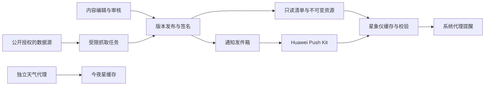

# 星象仪内容、通知与资源服务

## 本次决定与交付边界

用户界面保留“天象事件”“卫星通过”两个订阅入口，卫星项内放提前量，独立静默时段适用于全部本地订阅；专题内容服务可用后才显示“专题”。日历是按时间排列的图文事件卡，进入详情后只有日期、观测说明和“查看”。不要求用户管理任务队列、Token、下载地址或签名。

当前卫星订阅尚不可用：原生旧预测器会临时改变共享模拟状态，显式实际时间预测现返回 `explicit_epoch_prediction_unsupported`。客户端保留真实错误并关闭卫星订阅，不回退到模拟时间预测，也不显示订阅成功。需完成独立预测上下文后再开放。

本次提供可执行的订阅/推送消息/签名清单契约和测试，修复现有镜像及卫星更新的已发现缺陷。**v2 内容 HTTP 服务、Push 云端发送、客户端签名清单激活尚未部署/接通**；接口预留不等于后台更新已经上线。现有 `/v1/` 镜像继续兼容；不得拿 v1 的 SHA-256 清单冒充已签名 v2 发布。

## 证据与借鉴范围

- 新增 build 763 资料对照见 [SkyGuide 763 行为参考](../research/SKYGUIDE-763-REFERENCE-2026-11-11.md)：区分报告观察、源码实现、平台约束和待验证建议；全球事件时刻、当地观测情况、通知排程各自维护依赖，不能用一次资源下载或提醒发布推断整条链路可用。
- SkyGuide 历史分析：`/Users/jiexuanyang/Documents/Trae-CN/temp_20261014_01/skyguide-rev-eng/assets/analysis/notifications-widgets-tours.md`，记录本地排程、提前量、静默时段、去重、点击路由，以及 `FeaturedArticlesWidget → FeaturedArticleFeed`。
- 同目录 `../decompiled-source/SkyGuide_decompiled.c` 第 1078270 行有 Apple `didRegisterForRemoteNotificationsWithDeviceToken` 回调；`PlanetsExtension_decompiled.c` 第 19103 行有 `/Featured/latest.`。可确认存在远端通知接入代码及文章 feed，**不能由此断言生产文章的 APNs 发送方式、服务端结构或送达率**。
- 今夜星本地源码 `/Users/jiexuanyang/Documents/nightwindow`：天气服务器与客户端已有缓存、回退、0.5° 网格复用及原子写入。复用设计或代码需遵守其 AGPL-3.0 许可；不要复制密钥、用户数据或混用两个 App 的 token。

## 三条独立通道

| 业务 | 主通道 | 用户体验与失败行为 |
| --- | --- | --- |
| 已知天象、卫星过境 | 客户端计算 → `reminderAgentManager` | 用户订阅后滚动排入有限事件；应用关闭后由系统提醒。未获权益时明确告知，不能显示“设置成功” |
| 新专题、临时重要天象 | 内容发布 → 推送发件箱 → Huawei Push Kit | 用户分别订阅；点击到已发布内容，过期不补发。文章不是日历闹钟 |
| TLE、流星雨目录、小型星表增量 | HTTPS 签名清单 → 校验暂存 → 原子激活 | 缓存先可用，后台检查；失败保留旧版本，不弹打断式下载窗口 |

Push Kit 的后台消息在应用不在前台时会缓存，应用启动后才交给应用处理；不能把它当作通用后台唤醒器。普通通知可在应用进程不存在时由系统显示，但网络、睡眠策略和频控仍影响时效。分钟级卫星过境不依赖远端通知。

代理提醒在 API ≤25 限 30 个，API26 起限64个。首版自动订阅每类最多6条，应用自动调度总预算24，为手动提醒和替换留余量；只取消本功能拥有的 reminderId。长期不打开 App 时有限排程会耗尽，不能承诺无限后台续排；获官方支持的后台刷新机制前，明确以启动/返回前台/设置或数据变更为补排时机。

## 服务器拓扑与资源预算

继续复用现有 ECS 的 nginx 443，不新增公网管理端口。资源抓取、天气、订阅 API、推送 worker 分别使用普通系统用户；管理入口仅受控运维连接。首版使用静态 JSON + SQLite/WAL 发件箱，不引入 Redis/Kafka/Kubernetes。数据库与签名密钥不得放在网站根目录。

现场 2026-11-11：2核、1870MiB RAM，约1404MiB可用；40GiB磁盘约5.2GiB已用。适合小规模目录/内容索引、天气缓存和低频消息任务，不代表高并发大文件分发已压测通过。历史带宽3Mbps需控制台复核；若仍是3Mbps，理论总吞吐约0.375MB/s，100MB单用户下载也至少约267秒。高清巡天、整套纹理应按需求接入对象存储/CDN，先保留可迁移的资源源站接口，不自动购买服务。

## 预留 HTTP 契约（尚未公开部署）

| 方法与路径 | 身份 | 语义 |
| --- | --- | --- |
| GET `/v2/resources/current.json` | 公开、无设备ID | Ed25519签名信封；支持ETag/304，短缓存 |
| GET `/v2/blobs/{sha256}` | 公开 | 不可变内容，长缓存，Range可续传；返回实际类型和长度 |
| GET `/v2/content/index?after={cursor}&language={locale}` | 公开 | 已发布文章/事件及删除标记；cursor来自服务端，分页和长度上限 |
| GET `/v2/content/{id}/{revision}.json` | 公开 | 不可变文章/事件，署名、来源、授权、发布时间、有效期 |
| POST `/v2/installations` | 限流注册 | 随机安装身份+Push token；建立限本安装、限本App的可撤销会话 |
| PUT `/v2/installations/me/subscriptions` | 安装会话 | 乐观revision更新，语言/时区/类别/勿扰，不上传观测经纬度 |
| PUT `/v2/installations/me/push-token` | 安装会话 | token轮换；撤销旧token绑定，禁止跨App移绑 |
| DELETE `/v2/installations/me` | 安装会话 | 立即停发并删除token/订阅；幂等，返回删除回执 |

安装认证不是把 Push token 当密码。API 不接受调用者提供的其他安装ID；注册需速率限制、短时挑战及平台能力可用时的应用真实性校验。消息发送、内容审核与密钥管理没有客户端 API；发件箱只允许可信发布流程写入。先完成身份/滥用验证，再启用公网写接口。

预留代码：`harmonyos/ets-source/state/OnlineContentContract.ts` 的 `PushRegistrationPort`、`ContentSyncPort`；`deploy/content-service/contracts.mjs` 的消息投递门禁和签名清单校验。没有未配置却返回成功的网络实现。

通知仅携带 `schemaVersion/messageId/category/issuedAt/expiresAt/reference(kind,id,revision)`，不携带可执行命令、任意外部URL或资源目标路径。客户端根据受限ID查询已校验的内容，不能信任推送正文去执行 CLI。旧文章修改沿用内容ID递增revision；重复消息按messageId幂等，撤回保留tombstone。日历事件另以稳定eventId关联本地事件，避免本地提醒和远端通知双发。

## 无感资源更新状态机

1. 启动直接加载随包或最后已验证版本，绝不等待网络才能进入星图。
2. 用户允许联网后，在首次前台就绪、超过更新间隔再次前台、网络恢复或受限更新提示时检查。TLE建议6小时、目录/文章建议24小时；并发合并、随机抖动、指数退避。提示只置dirty，不立即信任其中的地址。
3. 验证发布签名、可信keyId、有效期、最低客户端版本和单调generation；相同generation只能重用同一payload哈希。签名验证对**payload原始UTF-8字节**进行，禁止解析重序列化后验签。根公钥随应用分发，私钥仅存在发布端。
4. 比较资源SHA-256，未变化不下载。流式下载限长、超时、磁盘预算；临时文件中验证实际长度、哈希及格式/轨道时效。每个来源失败不影响其他独立资源，但同一事务的依赖集合必须完整。
5. 数据位于不可变代目录，通过单个激活记录原子切换；保留前一代及随包版本。拒绝路径穿越、符号链接越界、压缩炸弹和远程脚本。正在读取旧数据的引擎在帧安全边界切换；TLE变化后重算已有过境提醒。
6. 下载失败、签名异常、磁盘不足或崩溃重启均继续用旧版本；只在“资源状态”显示数据日期及失败原因。轨道已过期时暂停精确过境提醒，不伪装数据新鲜。大资源按用户的流量/Wi-Fi选项下载。

签名轮换需由旧信任链授权新公钥或发应用更新；紧急回滚发布**更高generation引用已知良好内容**，不放开降级保护。保留 `bundled-manifest`、`installed-manifest` 和激活记录，启动修复不能覆盖已下载版本。

## Push 发送与文章发布

- 编辑 → 校验 → 预览 → 审核 → 发布不可变版本 → 提交发件箱；重试不得重复发布或重复通知。文章为受限结构化段落/图片/引用，清理HTML和链接，图片有版权来源；不复制SkyGuide内容。
- 用户开启专题后才注册/上传token；隐私同意不等于推送订阅。token更新时同步替换，退出/撤回时撤销绑定；服务端加密存储，日志不输出token。客户端本轮已移除已有完整token日志。
- **系统直显通知在客户端代码执行前展示**，不能只靠客户端门禁实现勿扰。worker发送前读取最新订阅revision和当地时区，检查静默时段、类别、事件有效期与发送预算。停订立即抑制待发任务；已被系统接收的通知无法保证远端撤回。
- 文章默认至多每周一次汇总；临时天象按实际重要程度低频通知，禁止借“紧急”绕过系统频控。每消息独立TTL，不把过境结束后的通知补发到白天。
- 发件箱状态：pending → leased → accepted/failed/suppressed，租约过期可重试；provider受理不等于设备送达。用回执统计无效token、过期、限流等，指数退避及dead-letter；内容审核与投递日志分开。
- 天文计算/卫星位置在本地，服务端文章只按语言和订阅分发；天气查询仍属于今夜星独立数据用途。Push token、随机安装ID仍属于需披露的数据，不能说“没有SN就不涉及个人信息”。

## 安全现状与部署门槛

现场发现与修复记录见同目录镜像审计文档及 `deploy/tle-mirror/README.md`。历史安全基线中的staging描述仅指127.0.0.1:8080；公开镜像已通过网站nginx提供。

优先处理：无特权抓取与天气进程；严格格式/体积校验；原子发布；失败不删除客户端数据；限流及全局上游预算；内容签名与回滚；异机备份和实际恢复演练。systemd timer exit=0不代表每个资源新鲜；健康页须显示各来源最后成功时间、失败、过期状态与磁盘预算。

公开API不信任原始X-Forwarded-For，只有明确的本机反向代理覆盖该头后才读取。运维凭据与发布签名、Push服务凭据分离；不增大现有RAM权限。只读审计未证明云安全组、快照及异机备份配置，不能依据历史文档宣称完成。涉及新增系统账号、服务身份迁移和重启的生产部署要先备份并按既有维护授权执行，当前本地补丁不冒充已部署。

## 验收门槛与后续顺序

1. 先完成本地通知/日历真机闭环，核对Profile中的代理提醒能力与实际系统返回，验证停止进程后提醒、点击详情、撤订和勿扰。
2. 部署经测试的v1镜像修复与普通用户服务；验证错误CSV被拒、旧数据保留、重启恢复，补公开状态检查。
3. 发布端接入v2签名清单；客户端真正接入下载/验签/原子激活。覆盖断网、304、截断、篡改、旧签名、错误时钟、磁盘满、切换中崩溃。验收前不能自动替换正式用户资源。
4. 内容feed上线并填入有授权的文章，先不推送；验证删除、离线阅读、多语言fallback和深链。
5. 接入安装身份与Push Kit，先仅测试安装白名单验收；只有真实订阅、服务端门禁、回执和隐私说明齐备后开启正式投递。测试不会向真实用户群发。

## 官方依据（2026-11-11通过鸿蒙MCP读取全文）

- [Push Kit简介](https://developer.huawei.com/consumer/cn/doc/harmonyos-guides/push-kit-introduction)：后台缓存、直显通知、睡眠管控、4KiB限制、真机范围。
- [发送通知消息](https://developer.huawei.com/consumer/cn/doc/harmonyos-guides/push-send-alert)：通知发送与点击。
- [pushService](https://developer.huawei.com/consumer/cn/doc/harmonyos-references/push-pushservice)：token获取/更新/删除与消息接口，使用时按最低API23核对。
- [代理提醒](https://developer.huawei.com/consumer/cn/doc/harmonyos-guides/agent-powered-reminder)：场景限制、权益、Profile更新、有效提醒数。

本文替代 `NOTIFICATION-CONTENT-EXTENSION-DESIGN.md` 中“不接Push”的规划限制；实况窗和卡片是否可用仍需单独核对审批、业务场景与真机行为，不能仅由新 Profile 中出现相关能力字段推断已经可用，也不将远端功能描述为已经上线。
